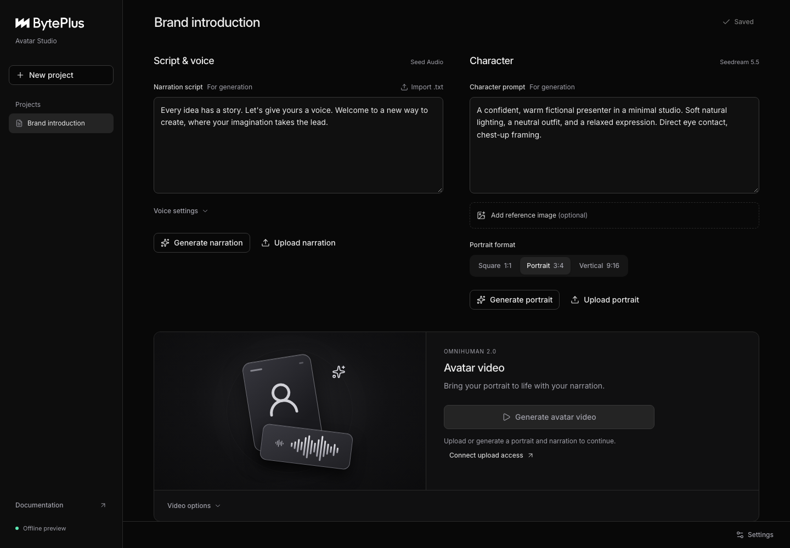

# BytePlus Avatar Studio

A review-first avatar creator for ComfyUI. Generate a portrait with **Seedream
5.5**, narration with **Seed Audio**, and a talking video with **OmniHuman 2.0**,
or bring your own image and audio.

*App preview with a sample project.*

Studio opens in your browser and uses your existing ComfyUI backend. It is a
separate extension, not a replacement for the node canvas. No Node.js or second
server is needed to use it.

**v0.2.0:** independent portrait and narration generation, including parallel
preparation, per-button progress and recovery for unresolved jobs.

## Install

**Requires:** ComfyUI >= 0.31.0 and
[ComfyUI-BytePlus-ModelArk](https://github.com/byteplus-sa/ComfyUI-BytePlus-ModelArk)
>= 0.10.0. Install the companion separately.

1. Download the Studio ZIP from [Releases](https://github.com/byteplus-sa/ComfyUI-BytePlus-Avatar-Studio/releases).
2. Extract it into `ComfyUI/custom_nodes/`, keeping the
   `ComfyUI-BytePlus-Avatar-Studio` folder and its bundled `studio_dist/`.
3. Restart ComfyUI.
4. Choose **BytePlus > Open BytePlus Avatar Studio** or its canvas context-menu
   entry.

Studio opens in an external browser, including when launched from Comfy Desktop.
For browser-only ComfyUI, you can also visit
`http://127.0.0.1:8188/byteplus/avatar-studio/`.

Manager installation requires **Active** Registry versions for both packages.
Pending or Flagged versions are not confirmed available through Manager.

## Set Up Keys

Save your provider keys in **ComfyUI Settings > BytePlus**:

| Service | Used for |
| --- | --- |
| ModelArk | Seedream portraits |
| Seed Speech | Seed Audio narration |
| Vision AI | OmniHuman video |

For video uploads, open Studio's bottom-right **Settings > API keys**:

- **Comfy Desktop:** launch Studio from ComfyUI and use **ComfyUI login**.
  No separate Comfy.org API key is needed. Keep the originating ComfyUI tab
  open; reopen Studio from ComfyUI after a reload. OAuth video submission
  requires an idle ComfyUI queue.
- **Browser-only ComfyUI:** set a **Comfy.org upload key**. It stays in tab
  memory by default. **Remember on this ComfyUI server** stores it in a
  private, plaintext file, not encrypted storage.

## Create An Avatar

1. Write or import your script and describe your character, optionally adding
   a reference image. Alternatively, upload a finished portrait or narration.
2. Generate any missing assets. Portrait and narration can run independently
   or at the same time, with separate progress indicators.
3. Review the portrait and listen to the narration, then **approve both**.
4. Generate the avatar video and download the result.

**Generate starts a paid BytePlus request immediately**, without an extra
confirmation. Local uploads and review do not submit generation requests.
Uploaded media does not need the corresponding image/audio generation key.

| Upload | Accepted files | Main limits |
| --- | --- | --- |
| Portrait | PNG, JPEG, WebP | 10 MB; 300-6000 px per side; <= 24 MP; aspect ratio 0.4-2.5 |
| Narration | WAV, MP3, FLAC | 64 MB; 4-300 seconds; non-silent |

Audio is prepared before review. Video length follows the approved narration;
clips are never truncated to fit. Replacing an asset requires approval again.

## Recovery And Privacy

- Uncertain paid requests are never retried automatically. Use **Collect task**
  for an existing video, or **Resolve preparation** after checking provider
  usage. Resolving a job does not cancel remote work or create a replacement.
- Remote cancellation works only for queued OmniHuman tasks. Stopping a local
  wait does not stop remote processing or billing.
- Use a **trusted, single-owner ComfyUI installation**; public/multi-user hosting
  is unsupported. Projects and media persist under the ComfyUI user directory.
  There is no automatic retention cleanup.

## Documentation

- [Setup, uploads and troubleshooting](https://github.com/byteplus-sa/ComfyUI-BytePlus-Avatar-Studio/blob/main/docs/usage.md)
- [Architecture, development and packaging](https://github.com/byteplus-sa/ComfyUI-BytePlus-Avatar-Studio/blob/main/docs/development.md)
- [License](LICENSE) and [third-party notices](THIRD_PARTY_NOTICES.md)
