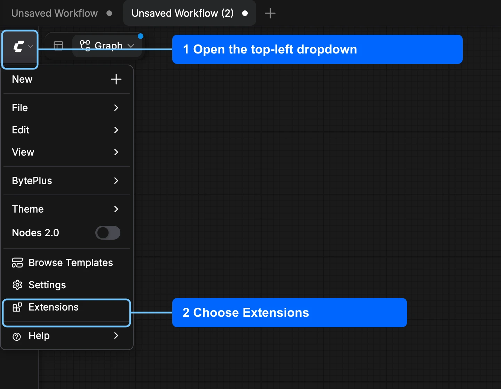
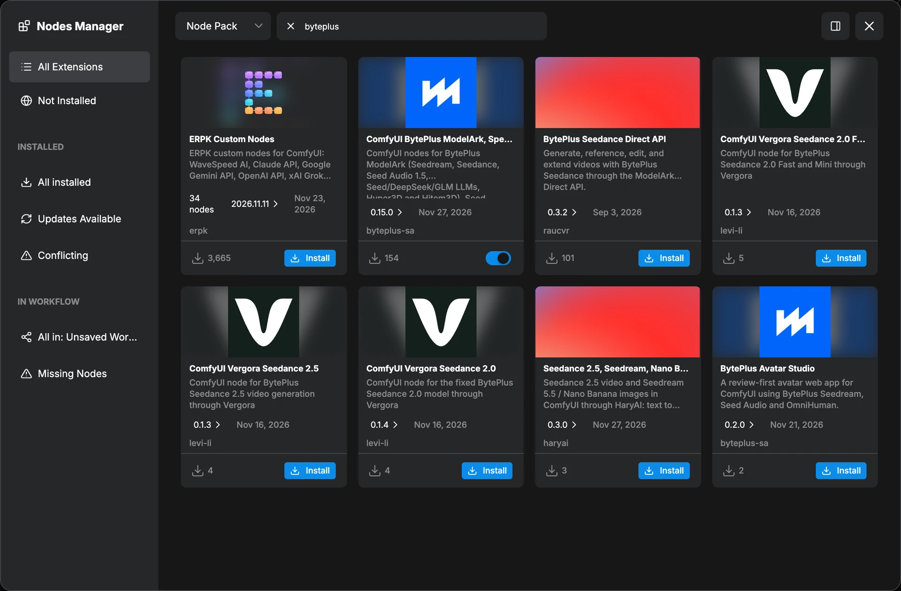

# BytePlus Avatar Studio

A review-first avatar creator for ComfyUI. Generate a portrait with **Seedream
5.5**, narration with **Seed Audio**, and a talking video with **OmniHuman 2.0**,
or bring your own image and audio.


*App preview with a sample project.*

Studio opens in your browser and uses your existing ComfyUI backend. It is a
separate extension, not a replacement for the node canvas. No Node.js or second
server is needed to use it.

**v0.2.0:** independent portrait and narration generation, including parallel
preparation, per-button progress and recovery for unresolved jobs.

## Install

**Requires:** ComfyUI >= 0.31.0 and
[ComfyUI-BytePlus-ModelArk](https://github.com/byteplus-sa/ComfyUI-BytePlus-ModelArk)
>= 0.10.0. Install the companion separately.

### Nodes Manager (Recommended)

Use **top-left dropdown > Extensions > Nodes Manager > search `byteplus` >
Install**. No separate ZIP download is needed.

1. In the ComfyUI editor, open the dropdown beside the **ComfyUI logo** at the
   top left. Choose **Extensions** to open **Nodes Manager**.
2. Keep **Node Pack** selected and search for **byteplus**.
3. Install **ComfyUI BytePlus ModelArk, Speech, OmniHuman & MediaKit**
   (`ComfyUI-BytePlus-ModelArk`) and **BytePlus Avatar Studio**
   (`ComfyUI-BytePlus-Avatar-Studio`), both from **byteplus-sa**.
4. If either package is already installed, open its card and choose **Update**
   when a newer release is available. Do not install a duplicate copy.
5. Wait for completion, then click **Apply Changes** if prompted, or restart
   ComfyUI. Reload the editor after the restart.





Use this same route for future updates to **both** packages. In older ComfyUI
layouts, open **Manager > Custom Nodes Manager**.

**No release is available for the selected update option?** Check the update
dropdown and the Registry versions; the message does not necessarily mean you
are up to date. A listing marked Active does not guarantee that each version
is approved. Pending or flagged versions may be unavailable through Manager
and the CLI.

### Comfy CLI (Second Option)

Configure [comfy-cli](https://github.com/Comfy-Org/comfy-cli) for the same
ComfyUI installation you open, then install the companion and Studio:

```bash
comfy node install ComfyUI-BytePlus-ModelArk
comfy node install ComfyUI-BytePlus-Avatar-Studio
```

For packages already installed, update instead:

```bash
comfy node update ComfyUI-BytePlus-ModelArk
comfy node update ComfyUI-BytePlus-Avatar-Studio
```

Restart ComfyUI and reload the editor afterwards. The CLI uses the same
Registry as Nodes Manager; it does not bypass release availability.

### Release ZIP (Last Resort)

1. Use a ZIP only when Manager and the CLI cannot install the required release.
   Install the [ModelArk companion](https://byteplus-sa.github.io/ComfyUI-BytePlus-ModelArk/get-started/install/)
   first, then download the Studio ZIP from
   [Releases](https://github.com/byteplus-sa/ComfyUI-BytePlus-Avatar-Studio/releases).
2. Close ComfyUI. Move any old Studio extension folder to a backup **outside
   `custom_nodes`**. Extract the new ZIP into
   `ComfyUI/custom_nodes/ComfyUI-BytePlus-Avatar-Studio/`, with `__init__.py`
   and the bundled `studio_dist/` directly inside it, not another nested folder.
3. Restart ComfyUI and reload the editor. Preserve the ComfyUI `user/` folder,
   including your Studio projects and `user/.env` credentials.

Manual ZIP extraction does not create Manager's `.tracking` metadata. If
Manager shows **Install** but fails with **Install path already exists**,
close ComfyUI, back up only the affected extension outside `custom_nodes`,
then reopen ComfyUI and install it through Nodes Manager. Do not remove your
user data or create an empty `.tracking` file.

## Open Studio

Choose **BytePlus > Open BytePlus Avatar Studio** or its canvas context-menu
entry.

Studio opens in an external browser, including when launched from Comfy Desktop.
For browser-only ComfyUI, you can also visit
`http://127.0.0.1:8188/byteplus/avatar-studio/`.

## Set Up Keys

Save your provider keys in **ComfyUI Settings > BytePlus**:

| Service | Used for |
| --- | --- |
| ModelArk | Seedream portraits |
| Seed Speech | Seed Audio narration |
| Vision AI | OmniHuman video |

For video uploads, open Studio's bottom-right **Settings > API keys**:

- **Comfy Desktop:** launch Studio from ComfyUI and use **ComfyUI login**.
  No separate Comfy.org API key is needed. Keep the originating ComfyUI tab
  open; reopen Studio from ComfyUI after a reload. OAuth video submission
  requires an idle ComfyUI queue.
- **Browser-only ComfyUI:** set a **Comfy.org upload key**. It stays in tab
  memory by default. **Remember on this ComfyUI server** stores it in a
  private, plaintext file, not encrypted storage.

## Create An Avatar

1. Write or import your script and describe your character, optionally adding
   a reference image. Alternatively, upload a finished portrait or narration.
2. Generate any missing assets. Portrait and narration can run independently
   or at the same time, with separate progress indicators.
3. Review the portrait and listen to the narration, then **approve both**.
4. Generate the avatar video and download the result.

**Generate starts a paid BytePlus request immediately**, without an extra
confirmation. Local uploads and review do not submit generation requests.
Uploaded media does not need the corresponding image/audio generation key.

| Upload | Accepted files | Main limits |
| --- | --- | --- |
| Portrait | PNG, JPEG, WebP | 10 MB; 300-6000 px per side; <= 24 MP; aspect ratio 0.4-2.5 |
| Narration | WAV, MP3, FLAC | 64 MB; 4-300 seconds; non-silent |

Audio is prepared before review. Video length follows the approved narration;
clips are never truncated to fit. Replacing an asset requires approval again.

## Recovery And Privacy

- Uncertain paid requests are never retried automatically. Use **Collect task**
  for an existing video, or **Resolve preparation** after checking provider
  usage. Resolving a job does not cancel remote work or create a replacement.
- Remote cancellation works only for queued OmniHuman tasks. Stopping a local
  wait does not stop remote processing or billing.
- Use a **trusted, single-owner ComfyUI installation**; public/multi-user hosting
  is unsupported. Projects and media persist under the ComfyUI user directory.
  There is no automatic retention cleanup.

## Documentation

- [Setup, uploads and troubleshooting](https://github.com/byteplus-sa/ComfyUI-BytePlus-Avatar-Studio/blob/main/docs/usage.md)
- [Architecture, development and packaging](https://github.com/byteplus-sa/ComfyUI-BytePlus-Avatar-Studio/blob/main/docs/development.md)
- [License](LICENSE) and [third-party notices](THIRD_PARTY_NOTICES.md)
