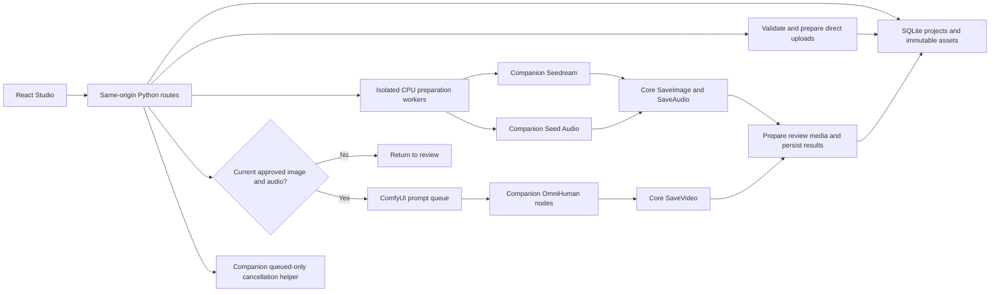

# BytePlus Avatar Studio

**Version 0.2.0:** generate portraits and narration independently or in parallel,
with per-button progress and no extra billing-confirmation dialog. Isolated CPU
workers preserve native ComfyUI cancellation, and explicit unresolved-preparation
recovery reopens a stage without automatically submitting replacement work.
Portrait and narration approvals remain required before video generation.

A separate ComfyUI extension with a bundled React web app for:

1. Write or import a script, or upload ready-made narration.
2. Describe a character with an optional reference, or upload a finished portrait.
3. Generate any missing portrait with Seedream 5.5 or narration with Seed Audio 1.0.
4. Review and explicitly approve each candidate.
5. Generate an OmniHuman 2.0 avatar video from the approved image and audio.

The node canvas remains unchanged. Studio opens as a full-page application in
a separate tab; end users do not need Node.js or a second application server.

## Interface

The Studio is a single validated form built with **shadcn/ui, Radix UI and
Tailwind CSS 4**, the official BytePlus wordmark and locally bundled Inter.
The near-black interface uses flat script/character sections, quiet model
labels and a compact project sidebar. There are no redundant breadcrumbs,
step indicators or separate review pages.

Avatar video has a compact illustrated panel: a monochrome portrait-and-waveform
composition beside the title, generation action, readiness message and upload-key
shortcut. Optional motion and watermark settings sit in its footer. The artwork
is static CSS and Lucide icons, marked decorative, not a sample result or actual
audio waveform. It requires no external image request or added dependency.
A returned video replaces it, with Download as the primary action and Generate
again as the secondary action. Queued/running/unknown labels reflect real job
state rather than invented progress.

Script, character prompt and optional reference upload stay visible. Language
and voice direction live under **Voice settings**; motion guidance and watermark
controls live under **Video options**. Collapsing options preserves their values.
Validation reopens a section containing an error and focuses the affected field.
The script counter becomes visible near the limit. Media previews and approval
controls appear only after a candidate exists; the video player appears only
after a result exists. Explicit approval is still required for each asset.

Approval actions sit below the media being reviewed. Click a portrait to open
a larger preview with a download action; opening or closing the preview never
approves it. Approved assets show one quiet status instead of repeated badges
and disabled approval buttons. Video guidance distinguishes missing media from
missing approval and names the asset that still needs attention.

Field errors appear on blur or when generation is attempted. Required inputs,
length limits, the combined Seed Audio prompt budget and upload-key format are
checked before submission. Invalid generation attempts focus the affected field.
Incomplete drafts can still be saved; Enter saves the draft, never generates.
**Ctrl+S / Cmd+S** also saves with the same validation, except while a dialog is
open. The save control distinguishes unsaved, saving and saved states. Failed
saves preserve the draft and bring the error into view.
Video remains disabled until current assets are approved, inputs are valid,
and upload access is configured in Settings. There is no separate permission
checkbox or permission-flag gate, including for older projects.

The desktop app fills the viewport. The sidebar stays full-height, only its
project list scrolls, and the editor scrolls independently beside it. Settings
occupies a reserved bottom utility row and cannot overlap the scrolling form.
Mobile project navigation opens in a keyboard-accessible side sheet.
At six or more projects, a local search field appears in the sidebar and mobile
sheet. Search ignores case and surrounding spaces, supports clearing/no-match
states, and does not modify the current draft. Completed activity is collapsed
by default; failures, unresolved tasks and recovery controls remain visible.

Editor state is separated from the form sections. Polling preserves unsaved
drafts, detects conflicting edits from another tab, and ignores outdated
responses. Short save/submission requests are serialized; duplicate Generate
clicks cannot submit another operation. Generate saves valid edits and starts
the selected request directly, without a second billing confirmation.
Radix dialogs contain keyboard focus, restore it on close, and block dismissal
while an operation is pending.
The bottom-right **Settings > API keys** dialog manages upload access outside
the creation form. When opened from a compatible Comfy Desktop instance, Studio
links to its native login by default. An upload API key remains an explicit
alternative. Keys stay in tab memory unless server persistence is selected;
Studio never stores login tokens in browser storage.

## Install

- Install ComfyUI-BytePlus-ModelArk **v0.10.0 or newer**.
- Use ComfyUI **v0.31.0 or newer**; native checks were run on **v0.31.0 and v0.45.4**.
- Place this folder at `ComfyUI/custom_nodes/ComfyUI-BytePlus-Avatar-Studio`.
- For the manual-install ZIP, extract it directly into `ComfyUI/custom_nodes/`;
  it contains the correctly named extension folder.
- Keep `studio_dist/` with the Python extension. The distribution includes it.
- Restart ComfyUI.
- Open **BytePlus > Open BytePlus Avatar Studio**, use the canvas context-menu
  entry, or visit `http://127.0.0.1:8188/byteplus/avatar-studio/`.

The Registry package is **ComfyUI-BytePlus-Avatar-Studio**, configured for the
**byteplus-sa** publisher. Use Manager installation only after its version is **Active**;
Pending or Flagged does not mean available. Source/manual installation remains
an alternative. Studio requires a separate companion installation and does not
replace it or install it automatically.

**Release prerequisite:** check the current Registry status of both Studio and
ModelArk before relying on Manager installation. Studio publication does not
resolve the companion's review.
The ZIP contains runtime code and the built frontend, not development sources,
tests, local state or credentials. Runtime Python packages are supplied by
ComfyUI; Studio adds no Python provider dependencies. License terms and bundled
frontend notices are in `LICENSE` and `THIRD_PARTY_NOTICES.md`.

## Credentials And Billing

Provider keys remain in the companion's existing **ComfyUI Settings > BytePlus**
editors. Studio's API keys dialog shows their connection status and includes
**Manage in ComfyUI** and **Refresh connections** controls under **BytePlus
connections**. This section starts collapsed when all provider keys are
configured, and expanded when setup needs attention.

| Service | Variable |
| --- | --- |
| ModelArk / Seedream | `BYTEPLUS_API_KEY` |
| Seed Speech / Seed Audio | `BYTEPLUS_SEED_SPEECH_API_KEY` |
| Vision AI / OmniHuman | `BYTEPLUS_CV_API_KEY` |

Connected image/audio inputs additionally require authenticated Comfy.org storage.
Use either a linked Desktop login or an upload API key, not both.

### Comfy Desktop Login

1. Open ComfyUI in **Comfy Desktop**, then launch Studio from the BytePlus menu
   or canvas context menu. Studio still opens in your system browser.
2. Open **Settings > API keys > ComfyUI login** in Studio.
3. If signed out, choose **Sign in with ComfyUI** and finish Desktop's native
   OAuth authorization in the system browser.
4. A connected Desktop login is selected automatically for video uploads.

No separate Comfy.org API key is needed for this path. Studio uses Desktop's
host OAuth session, not the older email/password login dialog inside the
ComfyUI canvas. The BytePlus provider keys above remain separate.

Keep the originating ComfyUI tab open. **Reloading Studio requires reopening
it from ComfyUI to reconnect.** The Studio-side link lives only in memory;
it expires after eight hours or a server restart. Logout, account/workspace
changes, a closed source tab and expired links block new submissions. Studio
never silently switches to a saved API key after a selected login fails.
**Use API key instead** explicitly selects that alternative.

The launcher sends a short-lived, single-use pairing code in a URL fragment,
which Studio removes immediately. That code is not an OAuth token. Before a
video request, the backend asks the specific originating Desktop tab for fresh
authorization over its existing websocket. The token goes directly into
ComfyUI's sensitive execution context; it is never returned to the Studio
browser, written to a project/database, or saved by this extension.
Refresh tokens remain owned by Desktop. Disconnecting Studio does not sign
out Desktop globally or cancel previously accepted work.

This integration feature-detects `__comfyDesktop2.Auth`; it was tested with
**Comfy Desktop 1.1.9** and **ComfyUI frontend 1.58.5**. Browser-only ComfyUI,
direct Studio URLs and Desktop builds without that bridge retain API-key
access. Studio does not scrape private frontend stores or browser credentials.
Authorization is refreshed before queue submission. **OAuth video submission
requires an idle ComfyUI queue**, so the token is not placed behind existing
long-running work. A busy queue returns a wait-and-retry message before queuing;
wait for it to finish and click Generate again, or select an
upload API key to use normal queuing. There is no mid-execution refresh, so
logout or expiry during upload can still fail. Uncertain paid work is never
automatically resubmitted.

The adapter follows the upstream [Desktop auth bridge contract](https://github.com/Comfy-Org/ComfyUI_frontend/blob/v1.58.5/src/platform/auth/desktopHost/desktopHostAuthBridge.ts)
and [local OAuth architecture](https://github.com/Comfy-Org/ComfyUI_frontend/blob/v1.58.5/docs/adr/AUTH-LOCAL-0043-local-comfyui-signs-in-through-cloud-oauth.md).

### Upload API Key

1. Open the bottom-right **Settings** button.
2. Choose **API keys > Set API key** under **Comfy.org upload key**.
3. Enter the key and choose **Use for this tab**, or explicitly check
   **Remember on this ComfyUI server** and choose **Save API key**.

**Session-only is the default.** The key stays in this tab's React memory and is
cleared by reload or tab closure. Only video submission sends it to the server,
using `X-Comfy-Org-Api-Key`.

**Remembered keys survive reloads and server restarts.** They are stored outside
the extension folder at:

```text
<ComfyUI user directory>/byteplus_avatar_studio/credentials/<SHA256 of user ID>.json
```

The file is **plaintext, not encrypted**. On macOS/Linux the credential directory
uses mode `0700` and files use `0600`; Windows ACLs are not managed or verified.
Use only a trusted ComfyUI server. The ComfyUI process, administrators and backups
with access to this directory can read the saved value. Hashing the filename
scopes it to the ComfyUI user; it does not encrypt the key.

The settings API returns only whether a key is configured, never its value.
Saved-key video submissions send `use_saved_upload_key: true`; the server
resolves the requesting user's key and forwards it through ComfyUI's sensitive
queue context. Neither mode writes the key into projects, SQLite, browser
storage, workflow metadata or Studio logs.

**Replace** always opens an empty field. Choosing session-only replacement
removes the previous server copy first. **Remove** clears this tab's key and the
saved server copy, but does not clear session keys in other tabs, revoke the key
at Comfy.org, erase backups or stop queued/running work. File errors are reported
without returning stored contents. Saving validates format, not live API access,
and never starts generation.

Studio never treats the Vision AI key as a ModelArk, Seed Speech or Comfy.org key.

Clicking Generate authorizes that paid request; there is no extra confirmation
dialog. Direct media uploads are local operations and do not submit paid
generation requests.

## Independent Preparation

Portrait and narration have independent Generate buttons. Start either one,
or start the other while it is running: the companion nodes execute concurrently,
not one behind the other in ComfyUI's prompt queue. Each button shows its own
starting/generating spinner or needs-attention state. Reloading Studio preserves
the running jobs while the server remains open.

An active stage locks its own inputs, uploads, regeneration and approval, while
the other stage remains usable. Video generation waits until neither stage is
active or unresolved and both current assets are explicitly approved. A failed
or interrupted request never starts a replacement automatically.

Preparation graphs and text-only narration are validated before execution.
Each preparation then starts a separate CPU worker, where `PreparationRunner`
invokes the existing Seedream/Seed Audio nodes and core image/audio savers.
Workers do not share ComfyUI's process-global interrupt flag, so cancelling a
native workflow cannot cancel Studio or lose its cancellation to Studio.
This isolation adds worker startup time and memory usage; no local GPU model is
loaded. Provider transports are not duplicated, and the normal queue is unchanged.

Only the relevant provider key and region are passed through a private stdin
pipe, never command arguments or temporary credential files. Worker logs are
suppressed; its response contains only safe state and saved-media metadata.
Known pre-execution validation/setup failures leave the stage editable.
Uncertain execution remains unresolved without automatically retrying.
Use **Resolve preparation** in Activity after checking provider usage to dismiss
that local operation and reopen its stage. This neither cancels remote work nor
generates a replacement; existing remote work may still be billed. Active or
collectable results cannot be dismissed.

Progress stays in Studio. Video and recovery retain the native queue. Shutdown
terminates active local workers, and a stdin watchdog exits the worker if its
parent backend dies. A restarted server marks missing work unresolved without
submitting again.

## Upload Your Media

Use **Upload portrait** or **Upload narration** next to the corresponding
generation button. You can upload both inputs or combine one upload with one
generated result. The script and character prompt are needed only for
generation, not for uploaded media.

| Input | Accepted Files | Limits |
| --- | --- | --- |
| Portrait | PNG, JPEG, WebP | 10 MB; still image; 300-6000 pixels per side; at most 24 MP; aspect ratio 0.4-2.5 |
| Narration | WAV, MP3, FLAC | 64 MB source file; 4-300 seconds; non-silent |

Portraits are orientation-corrected and stored as RGB PNG without source
metadata. Audio is prepared as mono PCM16 WAV at 24 kHz **before review**,
without speed, pitch or loudness adjustments. Clips are never truncated to fit.
M4A/MP4, URLs and playlists are not accepted by this uploader.

Uploads appear as **Uploaded** review candidates and are never automatically
approved. Replacing either file clears that asset's approval and the current
video selection. Invalid, stale or canceled uploads do not replace the current
candidate. Unsaved text is preserved; save it before approving.

**Add reference image** remains a separate Seedream input. It does not select
that picture as the portrait used by OmniHuman. Generation-only prompt, voice,
ratio and reference edits do not discard uploaded candidates or their approvals.
Generating a replacement still creates a new, unapproved candidate.

Local upload/review does not require provider credentials. Video generation
still requires the ModelArk companion, the Vision AI key and Comfy.org upload
access. Using uploaded audio does not require a Seed Speech key.

## Review And Recovery

- Approvals bind the current asset ID and SHA-256 hash.
- Script, language or voice-direction edits invalidate generated narration.
- Character prompt, format or reference changes invalidate generated portraits.
- Uploaded media remains bound to its file, not unused generation settings.
- New candidates are never implicitly approved.
- Stale revisions, changed bytes and duplicate active submissions are rejected.
- Each operation has a stable local seed/node identity; a new operation has a
  new seed. Uncertain acceptance is never automatically resubmitted.
- Narration is prepared **before review** as mono, 24 kHz PCM WAV. There are no
  speed, pitch or loudness adjustments. The approved prepared file is then used
  as the video input, and the companion may re-encode equivalent media for upload.
- OmniHuman requires one clip **4-300 seconds** long, inclusive. Seed Audio's
  combined script/style prompt limit is 3000 characters, not a guaranteed
  five-minute narration allowance. Short or silent results cannot be approved.
- Video duration follows the approved narration. There is no separate duration
  setting; trim or regenerate the audio before approving it to change the length.
- A failed/interrupted video keeps its task identity. **Collect task** uses the
  existing OmniHuman Task Result node, not a new generation or media upload.
- **Request cancellation** delegates directly to the companion's existing
  cancellation helper. It does not wait behind the video in ComfyUI's prompt
  queue. The provider can cancel queued work only; running work may continue
  and still be billed. Stopping a local wait is not remote cancellation.
- An unresolved image/audio submission without retained ComfyUI history stays
  unresolved. Inspect ComfyUI's queue/output and billing before replacing it;
  this release does not infer failure from missing history.

## Architecture



`avatar_studio/store.py` owns revision checks, approvals and job identity.
`workflows.py` builds restricted graphs. `bridge.py` owns ComfyUI integration.
`preparation_process.py` owns subprocess lifetime and private credential handoff.
`preparation_worker.py` loads the installed core/companion inside each CPU worker.
`preparation.py` runs the fixed image/audio graphs using native DynamicCombo
input conversion, isolated V3 hidden contexts and core media savers.
Generation input tokens bind each preparation to its own source fields and
current candidate; unrelated stage completion does not invalidate the request.
Older clients without these tokens still require an exact project revision.
`service.py` collects outputs and handles recovery. `routes.py` serves the app.
`upload_credentials.py` owns opt-in Comfy.org credential storage; provider keys
remain companion-managed.
`web/extension.js` is the launcher; app bundles live separately in `studio_dist/`
so ComfyUI does not auto-load them as extension scripts.

Project records and media live under
`ComfyUI/user/byteplus_avatar_studio/`. Core input/output directories also hold
workflow media. Restart recovery inspects known queue/history/task handles but
does not recreate lost queues or retry unknown paid submissions.

## Scope And Limits

This version targets a **trusted, single-owner ComfyUI installation**. Do not
expose ComfyUI publicly. It does not add authentication, a multi-user login UI,
storage quotas or retention/cleanup policies. Existing ComfyUI ownership checks
are enforced on Studio project and asset routes, but native ComfyUI media
directories themselves are not a public multi-tenant storage boundary.

Voice cloning, script rewriting, captions, long-script chunking/stitching,
automatic cost estimation and automatic approval are intentionally excluded.
Keep the service at the URL root; reverse-proxy subpath deployments are not yet
validated. Returned videos larger than 750 MB are not collected by this release.
All retained assets remain until explicitly managed outside Studio.

## Development And Verification

Use the full source folder for these commands; development files are excluded
from the manual-install ZIP.

Frontend:

```sh
npm --prefix frontend ci
npm --prefix frontend run test
npm --prefix frontend run lint
npm --prefix frontend run typecheck
npm --prefix frontend run build
```

`frontend/components.json` describes the shadcn component layout.
`src/components/ui/` contains locally owned components adapted from the
official `new-york-v4` registry, and `src/style.css` defines Tailwind theme
tokens and application layout. Tailwind compiles through `@tailwindcss/vite`;
there is no runtime CDN, Next.js application or separate frontend server.
See the [official shadcn Vite guide](https://ui.shadcn.com/docs/installation/vite)
and [manual setup](https://ui.shadcn.com/docs/installation/manual).

The optional shadcn scaffolding CLI is not installed: its current dependency
tree reported a moderate minimatch advisory during setup. The actual UI/build
dependencies installed here pass `npm audit` with zero known vulnerabilities.
Component licenses and adaptations are recorded in `THIRD_PARTY_NOTICES.md`.

Backend, using a Python environment with ComfyUI's dependencies:

```sh
python -m unittest discover -s tests -v
ruff check .
mypy -p avatar_studio
python -m compileall -q avatar_studio __init__.py
```

Native schema validation **does not queue generation**:

```sh
PYTHONPATH=. python tests/native_contracts.py \
  --comfy-root /path/to/ComfyUI \
  --companion-root /path/to/ComfyUI-BytePlus-ModelArk
```

Browser tests start a disposable local server using the real Studio HTTP routes,
store and service with a provider bridge that cannot submit generation. They
exercise editing, uploads, responsive layouts, approval gates, request conflicts
and keyboard navigation. Set the Python executable to an environment containing
ComfyUI's `aiohttp`, Pillow, NumPy and PyAV dependencies:

```sh
AVATAR_STUDIO_PYTHON=/path/to/comfy/python npm --prefix frontend run test:e2e
```

For native integration, use the included disposable server harness with the
ComfyUI Python interpreter and a released companion v0.10.0 or newer:

```sh
/path/to/comfy/python tests/native_server.py \
  --comfy-root /path/to/ComfyUI \
  --companion-root /path/to/ComfyUI-BytePlus-ModelArk \
  --studio-root /path/to/ComfyUI-BytePlus-Avatar-Studio \
  --port 8209
```

The harness uses temporary user/input/output/database directories, strips
provider credentials from the child environment, and enables only Studio and
the companion. It does not change the normal ComfyUI installation or its state.
Stop it with Ctrl+C to shut down the child server and remove temporary data.
Wait for `Starting server`, then verify readiness before starting the browser:

```sh
curl --fail http://127.0.0.1:8209/byteplus/avatar-studio/api/setup
AVATAR_STUDIO_URL=http://127.0.0.1:8209 \
  npm --prefix frontend run test:e2e -- e2e/studio.spec.ts \
  --grep 'ComfyUI loads the Studio launcher'
```

Use only a disposable URL: browser tests create projects and change synthetic
upload-key settings. The complete offline suite also uses fake job fixtures;
do not run it indiscriminately against a real ComfyUI server.

### Packaging

Build the frontend first, then create the manual-install distribution:

```sh
npm --prefix frontend run build
python scripts/package.py
shasum -a 256 -c ComfyUI-BytePlus-Avatar-Studio-0.2.0.zip.sha256
```

`scripts/package.py` checks matching frontend/backend versions, required files,
same-origin index asset references and symlinks. It includes only Python
runtime files, the launcher, built JS/CSS/font assets, metadata and licenses.
Development sources, tests, scripts, screenshots, local state and credentials
are excluded. Stable archive ordering, timestamps and permissions produce
identical ZIP bytes for unchanged inputs in the same build environment.
The archive is integrity-checked before replacing the previous ZIP; a SHA-256
sidecar is written alongside it. This command does not publish anything.

### Registry Releases

The dedicated repository is
[byteplus-sa/ComfyUI-BytePlus-Avatar-Studio](https://github.com/byteplus-sa/ComfyUI-BytePlus-Avatar-Studio).
Its manually dispatched **Publish Registry Release** workflow runs only on
`main`, after Studio unit, browser, lint/type/build/package checks and native
workflow validation on ComfyUI 0.31.0 and 0.46.0. Native CI uses the released
ModelArk v0.10.0 commit, not an uncommitted development checkout.

Maintainers set the repository's `REGISTRY_ACCESS_TOKEN` Actions secret to a
token for the `byteplus-sa` publisher. Never put it in Git, a workflow literal,
an issue or a chat message. Provider keys are not required by CI.

For each release, update matching backend/frontend versions, build and commit
`studio_dist/`, and use a previously unpublished semantic version. CI rebuilds
the frontend and rejects differences from its checked-in assets. Registry
packaging uses Git-tracked files and `.comfyignore`; it is distinct from the
manual-install ZIP. `scripts/check_registry_package.py` requires exactly the
tested runtime files plus the Registry icon and rejects unexpected content.

```sh
comfy --skip-prompt node validate
comfy --skip-prompt node pack
python scripts/check_registry_package.py node.zip
gh workflow run publish_action.yml --ref main
```

The workflow binds the version tag to the tested commit, publishes once and
creates the GitHub Release after upload. If upload fails ambiguously, inspect
the Registry before retrying: published versions cannot be overwritten.
Verify the version's security-scan status and the companion's availability
before announcing Manager installation. [Registry metadata](https://api.comfy.org/nodes/ComfyUI-BytePlus-Avatar-Studio)
and [version statuses](https://api.comfy.org/nodes/ComfyUI-BytePlus-Avatar-Studio/versions?include_status_reason=true)
are separate from a successful Actions run.

### Finalization Results

Latest local validation on **November 21, 2026**:

| Check | Result |
| --- | --- |
| Backend and distribution tests | 145 passed |
| Frontend unit tests | 54 passed |
| Offline browser tests | 56 passed; four native checks skipped here |
| Native launcher and login-broker checks | 4 passed in prior validation |
| Native workflow validation | 5 variants, parallel saver smoke and 5 isolated-worker checks passed |
| Ruff, mypy, ESLint, TypeScript, Python compilation and Vite build | Passed |
| npm audit | Zero known vulnerabilities |
| Package integrity and repeated-build checksum | Passed |

The runtime was tested on **ComfyUI 0.45.4 / frontend 1.58.5**, using released
**ModelArk v0.10.0 at c0ffd24** and isolated storage. Automated tests use fake
provider clients and synthetic auth; native websocket tests verify fresh
authorization, account-change refusal and source-tab disconnection without
queuing generation. Image, reference-image, narration, video and recovery
graphs validate against native node schemas.

The follow-up also verified **ComfyUI 0.31.0** with the released companion:
all five workflow variants and four native launcher/login checks passed using
the installed frontend 1.58.5. The harness now detects whether `--offline` is
supported, and native login tests work with an empty project store.
Synthetic older-host tests cover every missing auth-bridge method and rejected
token refresh. Native-queue smoke coverage verifies that simultaneous OAuth
requests cannot both enter an initially idle queue.

Separately authorized live tests passed with **Comfy Desktop 1.1.9**: one
1024 x 1024 Seedream portrait, 7.6803 seconds of Seed Audio, explicit review
and approvals, direct uploads into Studio, native Desktop launching, real
OAuth-backed Comfy.org uploads, and two completed 8-second OmniHuman videos.
Both videos decoded fully at 960 x 960, 24 fps, with H.264 video and AAC audio.
No Comfy.org API key was configured for those video requests.

The active cancellation attempt was not confirmed and its task completed.
A completed-task probe exposed HTTP 400/code 50217 from the provider; the
v0.10.0 companion recognizes that refusal only under HTTP 2xx. Studio now
maps that exact released-helper exception to "not canceled" without exposing
its contents or duplicating the provider client. Other failures remain errors.
The compatibility adapter passed a live completed-task smoke check.
ModelArk v0.11.0 fixes this response directly in its helper; Studio keeps its
adapter for released v0.10.0 installations.
All 33 OmniHuman tests pass, including redaction and unrelated-error cases.
A local HTTP fixture verifies successful queued cancellation and running-task
refusal through the real transport and node. This is not a new live provider test.
Successful cancellation while queued is still unverified; both completed
videos must be treated as billable. No replacement paid requests were made.

The finalization pass fixes four reproduced edge cases:

- Closing Settings no longer cancels app-wide saved-key readiness refresh.
- Imported scripts count Unicode code points consistently with the editor and backend.
- Canceled reference uploads clean prepared files without changing the project.
- Output-collection errors retain an observed provider task ID for recovery.

Tests cover happy paths, malformed and boundary inputs, ownership, stale
revisions, concurrent writes/uploads, credential-file failures, approval
invalidation and uncertain submissions. Desktop/mobile layout and media-review
coverage remains in the offline suite. Source review and a common-secret-pattern
scan found no embedded credentials or leftover runtime debug logging.

**Restart ComfyUI and reload Studio after installing this update**, since it
includes backend changes. Registry preparation and publication are described
above. Existing diagrams were checked against source; renderer validation was
not rerun during finalization.

Release verification also passed against ModelArk v0.11.0: all five native
workflow variants, parallel saver smoke, five isolated-worker checks and four
native launcher/login tests, using mocked providers and synthetic authorization.

**Still unverified:** paid parallel preparation, successful live queued
cancellation, paid five-minute video, older Desktop binaries, Windows worker
lifecycle and Windows credential ACL behavior.
Public/multi-user deployment remains unsupported. The local companion-root
`.env` is now owner-only (`0600`), with contents unchanged.

The full local companion suite ran 794 tests and reported five existing
Seedream/Seedance core-parity failures (display aliases, Flash ratio defaults
and Seedream schema options). Those unrelated schemas were left unchanged;
the companion-wide suite is not reported as fully passing. These findings
concern that separate development checkout, not the released companion used
by Studio's native checks. No additional paid calls were made during validation.

The architecture and contracts above govern implementation. Companion baseline:
[v0.10.0 at c0ffd24](https://github.com/byteplus-sa/ComfyUI-BytePlus-ModelArk/releases/tag/v0.10.0).
